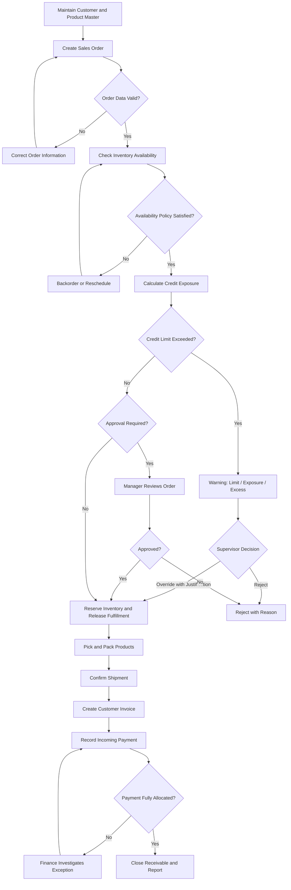
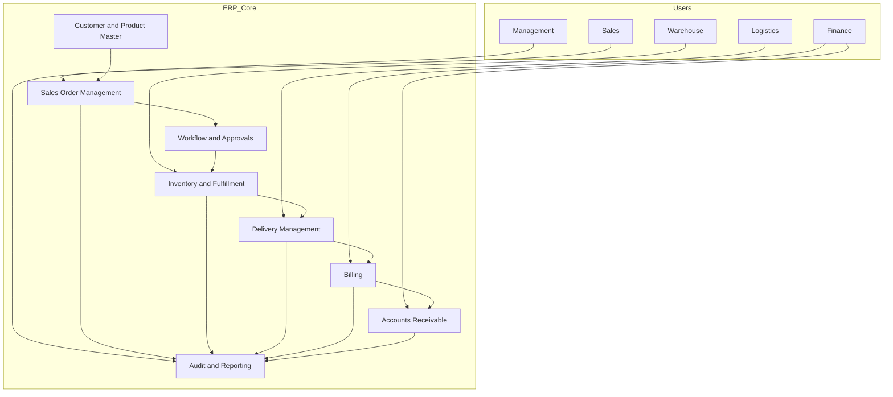

# DESIGN — ERP Functional Implementation Case Study: Order-to-Cash

**Version:** 1.2  
**Design Status:** Conceptual / Vendor-Neutral  
**Business Scenario:** Fictional Wholesale Distribution Company

---

## 1. Design Principles

The proposed ERP solution follows these principles:

1. **Process Before Product:** Understand business processes before mapping them to ERP capabilities.
2. **Standard Before Customization:** Prefer standard ERP capabilities before considering custom extensions.
3. **Single Source of Truth:** Define ownership for customer, product, inventory, and transaction data.
4. **End-to-End Traceability:** Maintain relationships between sales orders, deliveries, invoices, and payments.
5. **Least Privilege:** Users receive only the access required for their responsibilities.
6. **Segregation of Duties:** Separate incompatible responsibilities where practical.
7. **Human Accountability:** Authorized employees remain responsible for business and financial decisions.
8. **Measurable Operations:** KPIs must have clear definitions and consistent calculation methods.

---

## 2. Target Process Design

### 2.1 End-to-End O2C Stages

| Stage | Main Activity | Primary Owner | ERP Capability | Control Point |
|---|---|---|---|---|
| 1 | Maintain customer master | Master Data / Sales Ops | Customer Master | Unique ID and validation |
| 2 | Create sales order | Sales | Sales Order Management | Required fields validation |
| 3 | Check inventory | Inventory | Availability Checking | Stock commitment policy |
| 4 | Review exceptions | Sales Manager | Workflow / Approval | Authorization |
| 5 | Pick and pack products | Warehouse | Warehouse / Inventory | Quantity validation |
| 6 | Confirm shipment | Logistics | Delivery Management | Shipment reference |
| 7 | Generate invoice | Finance | Billing | Approved billing trigger |
| 8 | Record payment | Finance / AR | Accounts Receivable | Payment reconciliation |
| 9 | Monitor performance | Management | Reporting | KPI consistency |

### 2.2 Proposed Process Flow



The process is conceptual. Detailed status transitions, returns, partial deliveries, credit blocks, and billing rules require stakeholder validation.

---

## 3. Functional Capability Map

| Capability | Required Functionality | Design Considerations |
|---|---|---|
| Master Data | Customer and product management | Ownership and duplicate prevention |
| Sales | Order creation and modification | Commercial validation |
| Inventory | Stock availability and allocation | Inventory accuracy |
| Approval | Conditional order review | Approved business policies |
| Warehouse | Picking and packing | Fulfillment accuracy |
| Logistics | Shipment and delivery tracking | Delivery evidence |
| Billing | Customer invoice management | Billing trigger |
| Receivables | Payment recording and allocation | Financial reconciliation |
| Reporting | Operational dashboard | Consistent KPI definitions |
| Audit | Transaction history | User and timestamp tracking |

---

## 4. Fit-Gap Assessment Methodology

### 4.1 Classification

| Classification | Meaning | Recommended Action |
|---|---|---|
| Fit | Standard capability supports the requirement | Adopt standard process |
| Configuration | Existing capability requires setup | Configure and test |
| Extension | Validated business need requires additional functionality | Evaluate extension cost and risk |
| Integration | External data exchange is required | Design interface |
| Process Change | Existing business process must change | Prepare change management |
| Gap / Decision Required | Requirement or policy is unclear | Obtain business decision |

### 4.2 Initial Fit-Gap Hypotheses

These classifications are preliminary hypotheses, not claims about a specific ERP vendor.

| Requirement | Initial Hypothesis | Evidence Required |
|---|---|---|
| Customer Master | Fit / Configuration | Validate master data capabilities |
| Sales Order Management | Fit / Configuration | Validate order types and required fields |
| Inventory Availability | Fit / Configuration | Validate availability and allocation rules |
| Approval Workflow | Configuration / Extension | Validate approval policy and workflow capability |
| Warehouse Fulfillment | Fit / Configuration | Validate warehouse operating model |
| Delivery Confirmation | Fit / Integration | Validate logistics process |
| Billing | Fit / Configuration | Validate invoice trigger |
| Payment Allocation | Fit / Integration | Validate bank and payment processes |
| Operational Dashboard | Configuration / Extension | Validate reporting capabilities |

Final classifications must be validated against the selected ERP product, version, licensing, configuration, and official documentation.

---

## 5. Role and Authorization Design

| Role | Create Order | Change Order | Pick / Pack | Confirm Shipment | Create Invoice | Record Payment | View Dashboard |
|---|---|---|---|---|---|---|---|
| Sales Staff | Yes | Own / Permitted Orders | No | No | No | No | Limited |
| Sales Supervisor | Review | Authorized Exceptions | No | No | No | No | Sales |
| Warehouse Staff | No | No | Yes | Yes | No | No | Fulfillment |
| Finance Staff | No | No | No | No | Yes | Yes | Receivables |
| Management | No | No | No | No | No | No | Full |
| Admin | Technical Support | No Business Approval by Default | No | No | No | No | Technical |

This is the authoritative 6-role model from PRD.md. Responsibilities such as Inventory Controller, Logistics Coordinator, and Finance Manager are represented as permissions within these six roles. Final access requires organizational policy review and segregation-of-duties analysis.

---

## 6. Data Design

### 6.1 Core Data Entities

| Entity | Key Attributes | Data Owner |
|---|---|---|
| Customer | Customer ID, name, address, payment terms, status | Master Data / Sales Ops |
| Product | Product ID, description, unit, sales status | Master Data |
| Warehouse | Warehouse ID, location, status | Inventory |
| Sales Order | Order ID, customer ID, date, status, currency | Sales |
| Sales Order Line | Line ID, order ID, product ID, quantity, price | Sales |
| Inventory Balance | Product, warehouse, available quantity, reserved quantity | Inventory |
| Delivery | Delivery ID, order reference, shipment date, status | Logistics |
| Invoice | Invoice ID, order/delivery reference, amount, due date, status | Finance |
| Payment | Payment ID, customer, receipt date, amount, reference | Finance |
| Payment Allocation | Payment ID, invoice ID, allocated amount | Finance |

**Invoicing model:** Per delivery. One delivery generates at most one invoice; invoice quantities must match the actual delivered quantities; a delivery cannot be invoiced twice.

### 6.2 Data Quality Controls

- Unique identifiers for customers, products, and transactions.
- Duplicate detection.
- Valid units of measure.
- Valid customer payment terms.
- Controlled master-data modifications.
- Consistent date and currency handling.
- Reconciliation of migrated records.

### 6.3 Data Migration Sequence

1. Extract source data.
2. Profile data quality.
3. Identify duplicates and invalid values.
4. Define mapping and transformation rules.
5. Cleanse and approve master data.
6. Load customer and product master data.
7. Load relevant open transactions.
8. Reconcile record counts and transaction totals.
9. Obtain business sign-off.

The sequence must be adjusted to the capabilities and dependencies of the selected ERP.

---

## 7. Integration Design

| Interface | Direction | Data Exchanged | Key Considerations |
|---|---|---|---|
| CRM / Customer Portal | Inbound or Bidirectional | Customer and order information | Data ownership |
| Warehouse System | Bidirectional | Stock and fulfillment updates | Inventory synchronization |
| Carrier Platform | Bidirectional | Shipment and delivery status | Delivery evidence |
| Banking Channel | Inbound | Bank statements and payment information | Reconciliation |
| Reporting Platform | Outbound | Orders, deliveries, invoices, payments | Data consistency |

Each integration should define:

- Authentication and authorization.
- Data ownership.
- Error handling.
- Retry strategy.
- Duplicate prevention.
- Monitoring.
- Interface documentation.

These interfaces are conceptual and are not implemented in this portfolio case.

---

## 8. Exception and Control Design

| Exception | Expected Handling | Responsible Owner |
|---|---|---|
| Incomplete Customer Master | Block or return for correction | Master Data |
| Inactive Product | Prevent order line or require approved exception | Sales Ops |
| Insufficient Inventory | Backorder or reschedule | Inventory / Sales |
| Order Approval Rejected | Record rejection reason | Sales Manager |
| Partial Shipment | Track fulfilled and outstanding quantities | Warehouse / Logistics |
| Delivery Discrepancy | Record exception and evidence | Logistics |
| Invoice Mismatch | Hold for Finance review | Finance |
| Unmatched Payment | Route for investigation | Finance / AR |
| Unauthorized Access | Deny action and record security event | IT Security |
| Self-Approval Attempt | Block approval and require another supervisor | System |
| Partial Order Cancellation | Cancel only undelivered quantities; release reservations | Sales / Warehouse |
| Invoice Void with Allocations | Not allowed in MVP | Finance |

---

## 9. UAT Design

### 9.1 Test Coverage

The UAT process should cover:

1. Standard end-to-end O2C transaction.
2. Invalid customer information.
3. Invalid product information.
4. Insufficient inventory.
5. Backorder processing.
6. Order approval and rejection.
7. Partial fulfillment.
8. Delivery confirmation.
9. Billing trigger validation.
10. Invoice correction.
11. Full payment allocation.
12. Partial payment allocation.
13. Unmatched payment handling.
14. Role-based authorization.
15. Transaction audit history.
16. Report reconciliation.

### 9.2 Example End-to-End Test

**Scenario:** A valid customer orders an available product. Any required approval is completed. Warehouse fulfills the order. Finance generates an invoice using the approved billing trigger. The customer payment is recorded and fully allocated.

**Expected Result:**

- Sales order is successfully created.
- Inventory availability is validated.
- Approval history is recorded when applicable.
- Fulfillment quantities are traceable.
- Delivery status is recorded.
- Invoice references the relevant transaction.
- Payment is allocated to the correct invoice.
- Transaction records reconcile.
- Users can only access information permitted by their roles.

### 9.3 Requirement Traceability

Every UAT scenario must contain:

- Test Case ID.
- Requirement ID.
- Business Rule ID.
- Test Scenario.
- Preconditions.
- Test Data.
- Execution Steps.
- Expected Result.
- Actual Result.
- Evidence.
- Defect Reference.
- Approval Status.

---

## 10. Cutover and Hypercare Design

### 10.1 Cutover Workstreams

- Master data freeze.
- Final data extraction.
- Data cleansing and migration.
- Open order reconciliation.
- Open receivables reconciliation.
- User and role provisioning.
- Integration validation.
- User training.
- Business readiness review.
- Go/no-go decision.
- Controlled production opening.

### 10.2 Go/No-Go Criteria

The implementation should only proceed when:

- Critical master data is reconciled and approved.
- Open transactions are reconciled.
- Critical UAT scenarios have passed or have formally approved dispositions.
- User access has been reviewed.
- Critical integrations have been validated.
- Support responsibilities are established.
- Business owners approve readiness.

### 10.3 Hypercare

During the stabilization period:

1. Monitor critical business transactions.
2. Track order, delivery, billing, and payment exceptions.
3. Classify incidents by severity and business impact.
4. Assign responsible owners.
5. Track resolution progress.
6. Publish operational status reports.
7. Transition to regular support after business sign-off.

---

## 11. Conceptual Solution Architecture



This diagram represents a logical vendor-neutral architecture. It is not a deployment diagram or a claim about the exact module structure of a particular ERP product.

---

## 12. Design Decisions and Open Questions

### Design Decisions

- Use Order-to-Cash as the primary process boundary.
- Maintain a vendor-neutral solution design.
- Prefer standard ERP capabilities before extensions.
- Keep financial and commercial approvals with authorized employees.
- Use synthetic data throughout the project.
- Maintain end-to-end transaction traceability.

### Open Questions

1. ~~Which ERP product and version will be selected?~~ **Resolved (2026-11-12):** custom implementation, not a vendor ERP.
2. Does the company use a separate Warehouse Management System?
3. What are the approved order and credit approval rules?
4. What event triggers invoice creation?
5. How are returns, credit notes, and cancellations handled?
6. Which payment channels and bank statement formats are used?
7. Which reporting platform will be used?
8. What data retention and audit policies apply?

These questions must be resolved before detailed vendor-specific configuration or implementation.

---

## 13. Technical Implementation Design (MVP)

**Note (2026-11-12):** This portfolio project implements a custom web-based system, not a vendor ERP product. The open question about ERP product selection is therefore resolved.

### 13.1 Technology Stack

| Layer | Choice |
|---|---|
| Runtime | Node.js LTS |
| Web framework | Express.js |
| Database | SQLite (better-sqlite3) |
| Templating | EJS |
| Auth | express-session + bcryptjs |
| Validation | express-validator |
| Testing | Jest + Supertest |

### 13.2 Application Architecture

Layered modular monolith:

```text
routes → middleware → controllers → services → repositories → database
```

- **Routes** define endpoints and apply middleware.
- **Controllers** handle HTTP request/response.
- **Services** own business logic and transaction boundaries.
- **Repositories** own all SQL.
- **Models** define entity shapes.

### 13.3 Implementation Scope

The MVP implements the full Order-to-Cash workflow, management dashboard, and audit trail. Tax calculation, payment gateway, bank reconciliation, general ledger, procurement, forecasting, multi-currency, and consolidated invoicing are out of scope.

See `docs/technical-design.md` for the complete technical design.

---

## 14. Revision History

| Version | Date | Changes |
|---|---|---|
| 1.0 | 2026-11-12 | Initial conceptual design. |
| 1.1 | 2026-11-12 | Role model reconciled to PRD (6 roles); credit warning + override added to process flow; per-delivery invoicing confirmed; technical implementation design added. |
| 1.2 | 2026-11-12 | Credit exposure includes the current order under approval; partial order cancellation added. |
