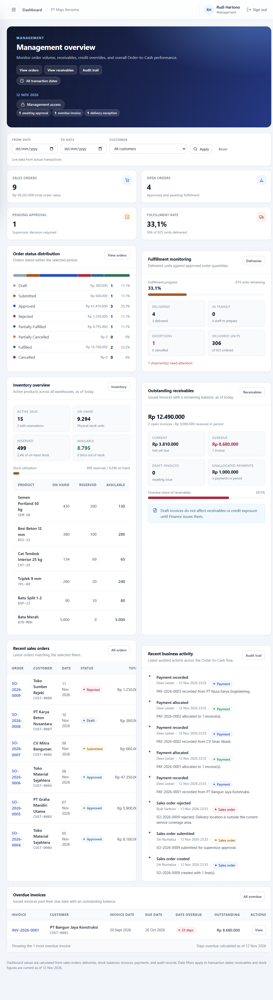
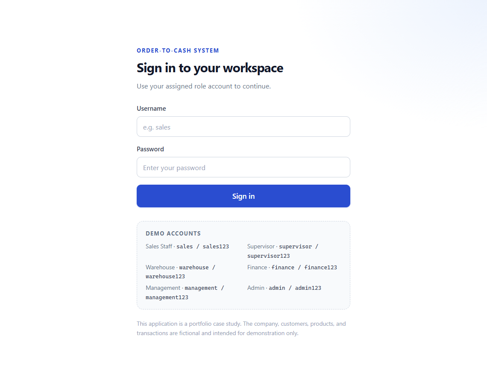
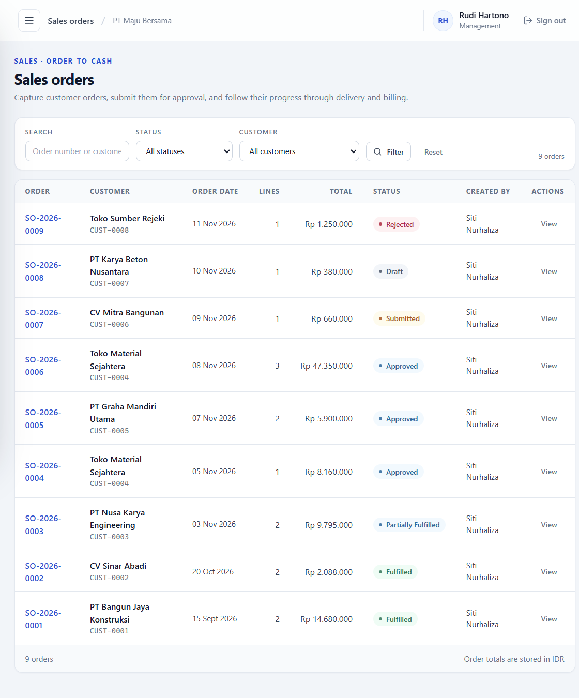
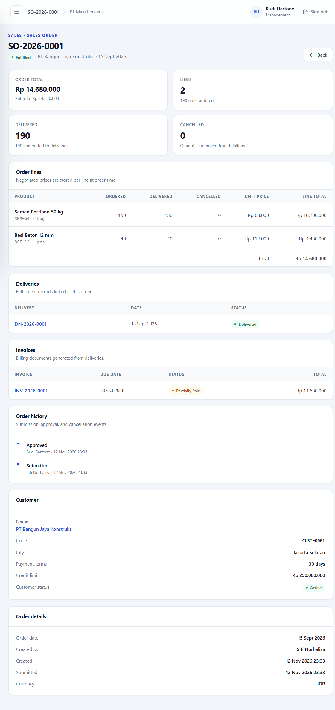
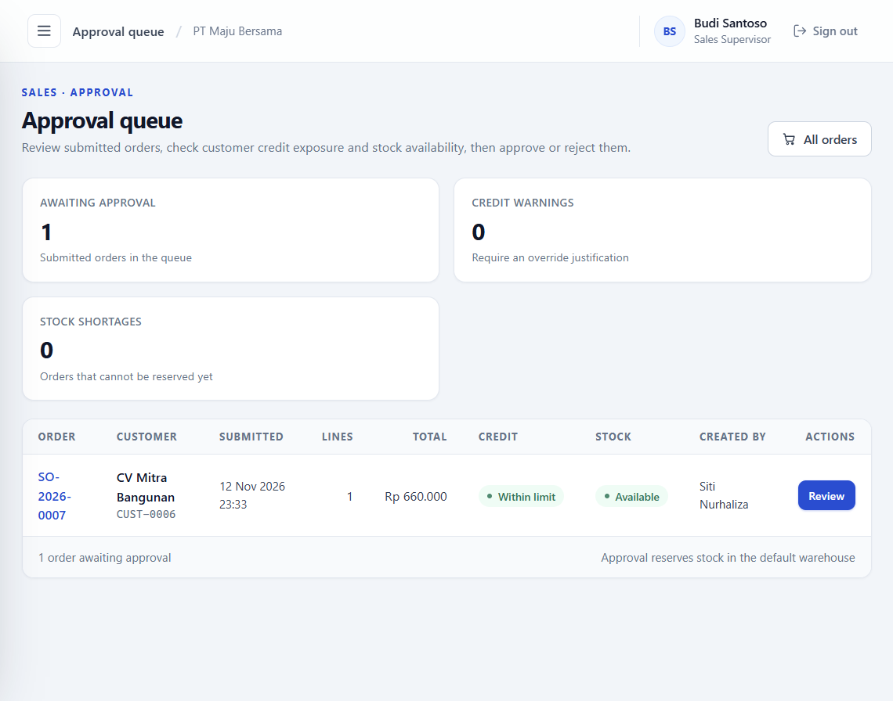
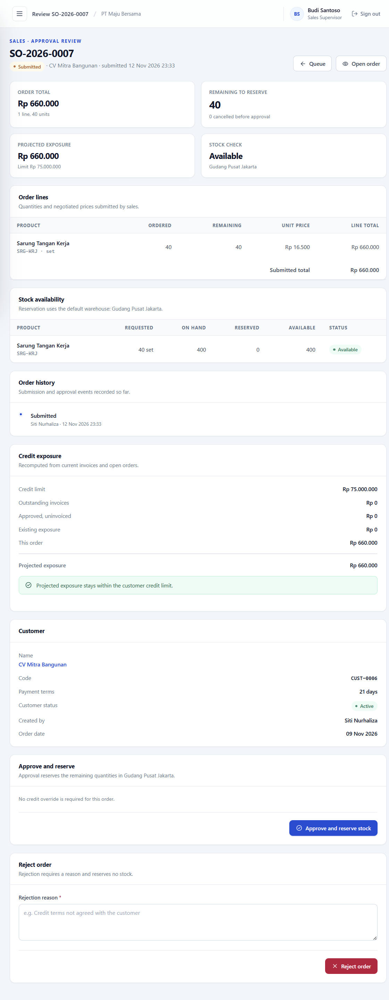
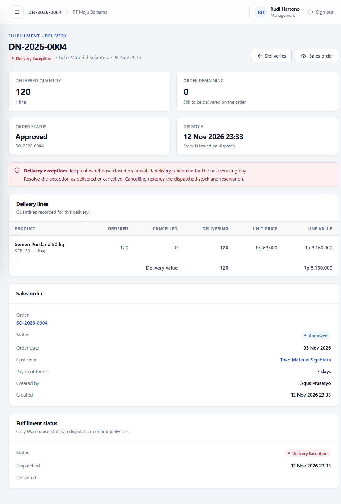
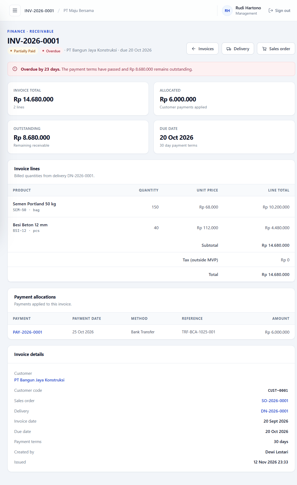
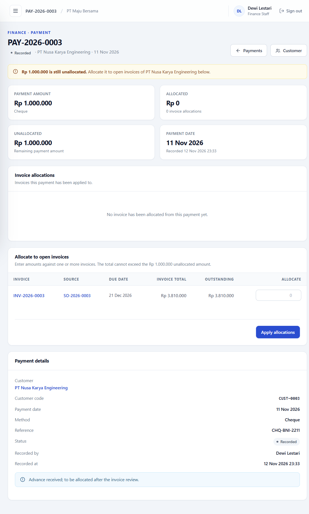
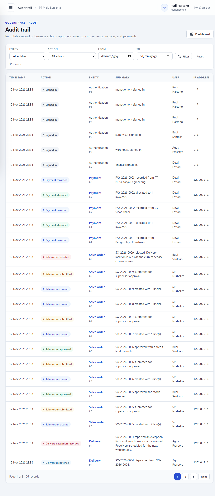

# B2B Order & Payment Management System

A working **Order-to-Cash (O2C)** application for a fictional wholesale distributor, **PT Maju Bersama**. It covers the full commercial cycle - sales order, supervisor approval, stock reservation, delivery, invoicing, payment allocation, receivables monitoring, and audit trail - with enforced business rules and transaction integrity.

Built as a portfolio case study that demonstrates both **business process analysis** and **practical full-stack implementation**. The company, customers, products, users, and transactions are entirely fictional.



---

## Table of Contents

- [Why this project](#why-this-project)
- [Screenshots](#screenshots)
- [Features](#features)
- [Roles and demo accounts](#roles-and-demo-accounts)
- [Business rules that matter](#business-rules-that-matter)
- [Technology stack](#technology-stack)
- [Architecture](#architecture)
- [Getting started](#getting-started)
- [Demo data](#demo-data)
- [Guided demo walkthrough](#guided-demo-walkthrough)
- [Testing](#testing)
- [Limitations and future enhancements](#limitations-and-future-enhancements)
- [Documentation](#documentation)
- [Project structure](#project-structure)

---

## Why this project

A distributor does not just "sell products". It commits stock, extends credit, ships in parts, invoices per shipment, collects payments, and has to explain every number afterwards. Most portfolio CRUD apps stop at the order form. This project models the **entire commercial chain and the controls around it**:

- Stock is not decremented when an order is created - it is **reserved at approval** and **issued at dispatch**.
- Credit exposure is checked at the **line level** against issued invoices plus open orders, with a warning and a mandatory supervisor override.
- Each delivery is invoiced **once**, with a controlled void-and-re-invoice path.
- Payments can cover **multiple invoices**, partially or fully, without ever over-allocating.
- Every consequential action lands in an **append-only audit trail**.

The result is a small but realistic ERP-style application where the interesting part is the business logic, not the screen count.

## Screenshots

| Login | Sales orders |
|---|---|
|  |  |

| Order detail and history |
|---|
|  |

| Approval queue | Credit and stock review |
|---|---|
|  |  |

| Delivery detail with exception | Invoice with partial payment |
|---|---|
|  |  |

| Payment allocation | Audit trail |
|---|---|
|  |  |

Screenshots were captured against the seeded demo dataset (`npm run db:demo`).

## Features

### Master data

- Customers with unique codes, payment terms, credit limits, and active/inactive status.
- Products with unique SKUs, categories, units, prices, and active/inactive status.
- Warehouses, including a protected default warehouse.
- User management with six roles and account status control.
- Inventory balances per warehouse, movement history, and manual adjustments with a mandatory reason.

### Sales orders

- Multi-line draft orders with generated `SO-YYYY-NNNN` numbers.
- Line totals and order totals calculated server-side.
- Draft editing and resubmission.
- Submission for supervisor approval.
- Full and partial cancellation with a reason, including release of reserved stock.
- Order history and status timeline.

### Approval and credit control

- Supervisor-only approval queue.
- Review of order value, stock availability, invoice exposure, open order value, projected exposure, credit limit, and excess.
- Line-level credit exposure assessment.
- Credit warning with a **mandatory justification** for override.
- Self-approval guard: a supervisor cannot approve an order they created.
- Atomic stock reservation on approval.
- Rejection with a mandatory reason.
- Competing approvals cannot over-reserve stock.

### Delivery and fulfillment

- Partial and full deliveries against approved orders.
- Generated `DN-YYYY-NNNN` delivery numbers.
- Dispatch issues stock; confirmation completes fulfillment.
- Delivery exceptions with a reason, resolvable as delivered or cancelled.
- Cancelling an exception reverses the stock movement and restores the reservation.
- Over-delivery and dispatch without reserved stock are blocked.

### Invoicing

- One delivery produces at most one active invoice.
- Invoice generation creates a **draft**; Finance must explicitly issue it.
- Due date derived from the customer's payment terms.
- Draft invoices do not affect receivables or credit exposure.
- Duplicate invoicing of the same delivery is blocked.
- Void requires a reason and is blocked once payment allocations exist.
- Voiding resets the delivery's invoiced quantity so the delivery can be re-invoiced.
- Overdue detection and days-overdue calculation.

### Payments and receivables

- Payment recording with date, amount, method, reference, and notes.
- Multiple invoice allocations in one submission.
- Partial payments and retained unallocated amounts.
- Allocation guards: same customer only, issued/partially paid invoices only, no allocation above the invoice balance, no allocation above the payment's unallocated amount.
- Payment and invoice statuses derived automatically (`recorded` → `partially_allocated` → `fully_allocated`; `issued` → `partially_paid` → `paid`).
- Allocation and status updates commit in one transaction.
- Receivables and overdue monitoring.

### Dashboard and audit

- Role-aware dashboard: order KPIs, order status distribution, fulfillment progress, inventory overview, receivables, overdue invoices, recent orders, and activity feed.
- Date filters apply to transaction dates; receivables and stock remain as of today.
- Customer filter across orders, deliveries, invoices, payments, and overdue invoices.
- Finance sections hidden from warehouse; inventory hidden from finance; audit restricted to Management and Admin.
- Append-only audit trail with entity, action, and date filters, pagination, and human-readable summaries.
- Audit entries record user, timestamp, entity, action, details, and IP address.

## Roles and demo accounts

| Role | Username | Password | Primary responsibilities |
|---|---|---|---|
| Sales Staff | `sales` | `sales123` | Customers, draft orders, submit for approval, cancel own drafts |
| Sales Supervisor | `supervisor` | `supervisor123` | Approval queue, credit override, rejection, order cancellation |
| Warehouse Staff | `warehouse` | `warehouse123` | Fulfillment queue, deliveries, dispatch, confirmation, exceptions, stock adjustments |
| Finance Staff | `finance` | `finance123` | Invoicing, invoice issuance/void, payments, allocations, receivables |
| Management | `management` | `management123` | Full dashboard, audit trail, read-only business visibility |
| Admin | `admin` | `admin123` | User management, master data, full operational visibility, audit trail |

All accounts are seeded for demonstration only.

## Business rules that matter

| Area | Rule |
|---|---|
| Order | Orders are created as drafts and must be submitted before approval. |
| Approval | Approval reserves stock atomically; insufficient available stock blocks approval. |
| Credit | Exposure is calculated from issued invoice balances plus open order value. A limit breach is a warning, not an automatic block. |
| Credit override | Approval above the credit limit requires a written justification, which is stored in the audit trail. |
| Approval ownership | A supervisor cannot approve an order they created. |
| Stock | On-hand stock is reduced at dispatch, not at order creation or approval. |
| Delivery | Delivered quantity cannot exceed the remaining ordered quantity. |
| Invoicing | One delivery → at most one active (non-void) invoice. |
| Invoicing | Draft invoices do not count as receivables or credit exposure. |
| Void | Voiding requires a reason and is blocked once the invoice has payment allocations. |
| Payments | A payment can be allocated to multiple invoices for the same customer only. |
| Allocation | Each allocation row may not exceed the invoice balance, and the total may not exceed the payment's unallocated amount. |
| Cancellation | Delivered or invoiced quantities cannot be cancelled. |
| Audit | Every consequential action is recorded; audit records cannot be edited or deleted. |

The full rule set is in [`PRD.md`](PRD.md) (BR-001 - BR-032) and mapped to tests in [`docs/requirements/traceability-matrix.md`](docs/requirements/traceability-matrix.md).

## Technology stack

| Layer | Choice |
|---|---|
| Runtime | Node.js (tested on v24.13.1) |
| Web framework | Express 5 |
| Rendering | EJS server-rendered views |
| Database | SQLite via `better-sqlite3` |
| Session | `express-session` |
| Security | Helmet, bcrypt password hashing, CSRF protection, role guards, parameterized SQL |
| Validation | `express-validator` plus service-level guards |
| Tests | Jest 30 + Supertest 7 against in-memory SQLite |

The stack is deliberately small: no SPA build step, no ORM, no external services. The focus is the domain logic and the controls around financial and inventory data.

## Architecture

The application uses a layered, server-rendered architecture:

```text
Browser (EJS forms)
   │
   ▼
routes            URL + HTTP verb + role guard
   │
   ▼
middleware        authentication, RBAC, validation, CSRF, error handling
   │
   ▼
controllers       request/response mapping, redirects, flash messages
   │
   ▼
services          business rules, status transitions, transaction boundaries
   │
   ▼
repositories      SQL queries and row mapping
   │
   ▼
SQLite            schema, constraints, transactions
```

Key properties:

- **Business rules live in services**, not in controllers or views.
- **Multi-step writes run in `db.transaction(...)`**: approval + reservation + audit, dispatch + stock issue, invoice + delivery-line update, payment + allocation + status refresh.
- **Server-rendered forms use POST endpoints** for state changes (no `PUT`/`PATCH`/`DELETE` verbs).
- **Role visibility is enforced server-side**, not just hidden in the UI.
- **Money and quantities are validated and rounded server-side.**

More detail: [`docs/technical-design.md`](docs/technical-design.md).

## Getting started

### Prerequisites

- Node.js 20 or newer (tested on Node v24.13.1)
- npm 10 or newer (tested on npm 11.8.0)
- Windows, macOS, or Linux

`better-sqlite3` is a native module. If installation fails, install build tools for your platform and reinstall dependencies.

### 1. Install dependencies

```bash
npm install
```

### 2. Create the environment file

PowerShell:

```powershell
Copy-Item .env.example .env
```

macOS/Linux:

```bash
cp .env.example .env
```

Default configuration:

```ini
PORT=3000
NODE_ENV=development
SESSION_SECRET=change-this-secret-in-production
DATABASE_PATH=./database/b2b.db
```

Change `SESSION_SECRET` for any non-local environment.

### 3. Initialize the database

Choose one:

```bash
# Master data only: users, customers, products, warehouses, opening stock
npm run db:reset

# Master data plus a realistic Order-to-Cash history (recommended for a demo)
npm run db:demo
```

Both commands recreate the SQLite file. **Stop the development server before running them**, otherwise Windows may report `EPERM` because the database file is locked.

### 4. Start the application

```bash
npm start
```

Open <http://localhost:3000> and sign in with any demo account above.

For development with automatic restart:

```bash
npm run dev
```

### 5. Run the tests

```bash
npm test
```

The suite uses in-memory SQLite (`DATABASE_PATH=:memory:`), runs serially (`--runInBand`), and does not touch the development database.

### Available scripts

| Script | Purpose |
|---|---|
| `npm start` | Start the server |
| `npm run dev` | Start with file watching |
| `npm run db:migrate` | Apply pending SQL migrations |
| `npm run db:seed` | Seed master data into an existing schema |
| `npm run db:reset` | Recreate the database with master data |
| `npm run db:demo` | Recreate the database with master data plus demo transactions |
| `npm test` | Run the Jest + Supertest suite |

## Demo data

`npm run db:demo` rebuilds the database and then creates history **through the application services**, so reservations, invoice balances, payment allocations, statuses, and audit records stay consistent.

The demo dataset contains:

- 9 sales orders covering every major status: `fulfilled`, `partially_fulfilled`, `approved`, `submitted`, `draft`, `rejected`.
- 4 deliveries, including a `delivery_exception`.
- 3 invoices: one `partially_paid` and overdue, one `paid`, one `issued`.
- 3 payments: two fully allocated and one with an unallocated balance.
- An approved order that required a **credit-limit override** with a written justification.
- Realistic stock levels with active reservations.

Key records to explore:

| Record | Why it is interesting |
|---|---|
| `SO-2026-0001` | Fulfilled order with a partially paid, overdue invoice |
| `SO-2026-0003` | Partially fulfilled order with a remaining quantity still to deliver |
| `SO-2026-0004` | Approved order with a delivery exception to resolve |
| `SO-2026-0006` | Credit-limit override with justification in the audit trail |
| `SO-2026-0007` | Submitted order waiting in the approval queue |
| `SO-2026-0008` | Draft order still being prepared |
| `SO-2026-0009` | Rejected order with a reason |
| `INV-2026-0001` | Overdue invoice with a partial payment |
| `PAY-2026-0003` | Payment with an unallocated amount ready to allocate |

## Guided demo walkthrough

A short end-to-end tour that touches every role:

1. **Sales Staff** - sign in as `sales`. Open an order, review the line-level totals, and submit `SO-2026-0008` for approval.
2. **Sales Supervisor** - sign in as `supervisor`. Open the approval queue, review stock and credit exposure, and approve the order. If the projected exposure exceeds the customer's credit limit, enter a justification to override.
3. **Warehouse Staff** - sign in as `warehouse`. Create a delivery for the approved order, dispatch it, then confirm it. Separately, open `DN-2026-0004` and resolve its delivery exception.
4. **Finance Staff** - sign in as `finance`. Generate an invoice from the confirmed delivery, issue it, then open `PAY-2026-0003` and allocate its unallocated amount to an issued invoice.
5. **Management** - sign in as `management`. Review the dashboard KPIs, filter by date and customer, then open the audit trail and filter by entity or action.
6. **Admin** - sign in as `admin`. Review user management and master data, and confirm the same audit visibility.

## Testing

Current result:

```text
Test Suites: 8 passed, 8 total
Tests:       73 passed, 73 total
```

| Suite | Tests | Focus |
|---|---|---|
| `auth.test.js` | 9 | Login, logout, session protection, user management |
| `master-data.test.js` | 10 | Customers, products, warehouses, categories, stock adjustments |
| `orders.test.js` | 14 | Drafts, totals, editing, submission, cancellation, visibility |
| `approvals.test.js` | 10 | Queue, credit warnings, overrides, rejection, reservation, concurrency |
| `deliveries.test.js` | 8 | Partial delivery, dispatch, confirmation, exceptions, reversal |
| `invoices.test.js` | 8 | Generation, duplicates, issuance, void/re-invoice, overdue |
| `payments.test.js` | 7 | Recording, partial payment, multi-invoice allocation, guards |
| `dashboard.test.js` | 7 | KPIs, filters, role visibility, receivables, audit trail |

Supporting evidence:

- [`docs/testing/test-plan.md`](docs/testing/test-plan.md)
- [`docs/testing/uat-scenarios.md`](docs/testing/uat-scenarios.md) - 15 UAT scenarios
- [`docs/testing/test-execution-results.md`](docs/testing/test-execution-results.md)
- [`docs/testing/defect-log.md`](docs/testing/defect-log.md) - 7 defects found and closed
- [`docs/testing/qa-report.md`](docs/testing/qa-report.md)

## Limitations and future enhancements

### Known limitations

- Tax is outside the MVP; invoices show subtotal only.
- No payment or allocation reversal; corrections require a compensating process outside the MVP.
- No credit-note workflow; void and re-invoice is the correction path.
- No PDF/Excel export.
- No bank reconciliation or general ledger integration.
- SQLite is a single-writer database and is not intended for high-concurrency production use.
- No formal WCAG accessibility audit or cross-browser test matrix.
- Dashboard date filters do not restrict receivables or stock, because those are as-of-today balances.

### Possible next steps

- Payment reversal and allocation reversal with audit.
- Credit notes and partial invoice adjustments.
- Tax configuration and e-invoicing integration.
- PDF invoices and Excel receivable aging exports.
- Bank statement import and reconciliation.
- Customer portal for order status and invoice download.
- Role-based notification queue for approvals, overdue invoices, and delivery exceptions.
- PostgreSQL migration and a proper concurrency/load test.
- Formal accessibility audit and end-to-end browser tests.

## Documentation

| Document | Contents |
|---|---|
| [`PRD.md`](PRD.md) | Business context, scope, functional and non-functional requirements, business rules |
| [`DESIGN.md`](DESIGN.md) | ERP fit analysis, process design, controls, and design rationale |
| [`PLAN.md`](PLAN.md) | Milestones, tasks, progress tracking, and revision history |
| [`docs/technical-design.md`](docs/technical-design.md) | Architecture, schema, routes, transactions, RBAC, UI design |
| [`docs/requirements/traceability-matrix.md`](docs/requirements/traceability-matrix.md) | Requirement → implementation → test mapping |
| [`docs/testing/`](docs/testing/) | Test plan, UAT scenarios, execution results, defect log, QA report |

## Project structure

```text
B2B/
├── src/
│   ├── app.js                 Express app and middleware wiring
│   ├── server.js              Startup, migrations, bootstrap seed
│   ├── config/                Environment and database connection
│   ├── database/
│   │   ├── migrations/        Numbered SQL migrations
│   │   ├── seeders/           Users, customers, products, inventory
│   │   ├── migrate.js
│   │   ├── seed.js
│   │   └── reset.js
│   ├── middleware/            Auth, RBAC, validation, CSRF, errors
│   ├── routes/                URL definitions and role guards
│   ├── controllers/           Request/response handling
│   ├── services/              Business rules and transactions
│   ├── repositories/          SQL queries and row mapping
│   ├── validators/            Form validation rules
│   ├── views/                 EJS templates by module
│   ├── public/                CSS and static assets
│   └── utils/                 Constants, formatting, numbering, audit, time
├── scripts/
│   └── seed-demo.js           Demo transaction generator
├── tests/
│   ├── integration/           8 Jest + Supertest suites
│   ├── helpers.js
│   └── setup.env.js
├── docs/                      Technical, testing, and requirements documents
├── database/                  SQLite database (gitignored)
├── PRD.md
├── DESIGN.md
├── PLAN.md
└── README.md
```

---

**Author:** Ferdinand Lauren  
**License:** MIT  
**Repository:** <https://github.com/FerdinandLauren/b2b-order-payment-management>

This is a portfolio case study. All companies, people, products, and transactions are fictional.
